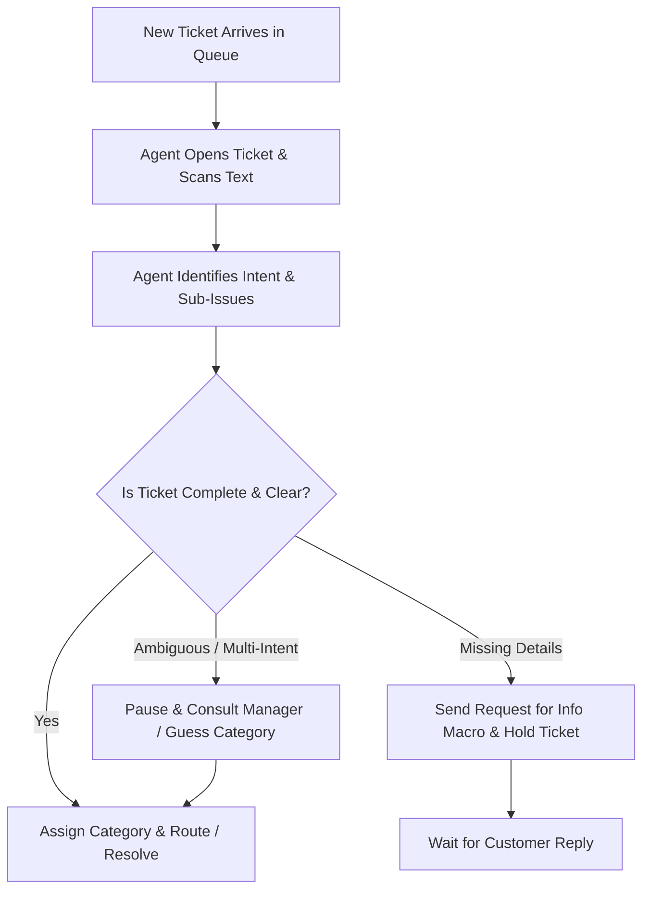

# Product Discovery Document
## Support Ticket Triage — Problem Exploration & User Research Foundation

**Project Name:** Support Triage AI  
**Role:** AI Product Manager & Product Designer  
**Document Stage:** Discovery & Problem Validation (Pre-PRD / Pre-Architecture)  
**Status:** Completed Initial Discovery Synthesis  

---

## 1. Executive Summary & Problem Space

Support ticket triage is the frontline operational process of receiving, parsing, categorizing, and routing inbound customer support inquiries to the appropriate resolution path. 

Before proposing solutions, AI architectures, or automated routing models, this discovery document explores the fundamental human, operational, and informational dynamics of ticket triage. The goal is to deeply map the problem space, identify user friction points, document assumptions, and formulate research questions to validate with domain practitioners.

---

## 2. User Segmentation & Stakeholders

### Primary Users: Tier 1 Support Agents ("Frontline Responders")
* **Context:** Responsible for managing incoming queues, resolving straightforward queries, and correctly triaging or escalating complex cases.
* **Operational Motivation:** Resolve customer issues quickly, meet First Response Time (FRT) and Resolution Time (MTTR) SLAs, avoid misrouting penalties.
* **Environment:** High ticket volume, fragmented context across CRM/helpdesk tools, continuous cognitive context-switching.

### Secondary Users: Support Operations Leads / Queue Managers
* **Context:** Responsible for overall queue health, load balancing across shifts, agent performance, and triage accuracy.
* **Operational Motivation:** Maintain predictable queue throughput, minimize ticket ping-pong between departments, ensure high CSAT.

### Indirect Stakeholders
* **Specialized Tier 2 / Tier 3 Teams (Billing, Engineering, Security):** Depend on Tier 1 to route only relevant, fully contextualized tickets to their specialized queues.
* **End Customers:** Experience the impact of triage quality directly through response speed, accuracy, and the frustration of repetitive detail requests.

---

## 3. Current Triage Workflow Analysis



### Core Micro-Tasks Performed During Triage
1. **Unstructured Parsing:** Reading unstructured email/chat body text, filtering out pleasantries and emotional venting to locate the core technical or operational issue.
2. **Detail Audit:** Verifying if essential troubleshooting metadata (e.g., account ID, transaction date, OS version, screenshot) is included.
3. **Intent Categorization:** Mapping the customer's stated problem to the organization's taxonomy (e.g., `Billing`, `Login`, `Refund`, `Technical`).
4. **Action & Routing Execution:** Applying tags, setting priority flags, updating ticket status, or assigning to specific team queues.

---

## 4. Major Pain Points & Friction Points

### Pain Point 1: Cognitive Fatigue & Context Switching
Agents read hundreds of varied, unstructured messages daily. Sifting through multi-paragraph complaints to extract a single underlying issue requires high mental effort, leading to fatigue and reduced accuracy late in shifts.

### Pain Point 2: Category Blur & Taxonomy Ambiguity
Categories in support systems are rarely mutually exclusive. For instance:
* A customer stating *"I can't log in because my subscription expired"* touches both `Login` and `Billing`.
* A customer stating *"You charged me after I cancelled"* touches both `Billing` and `Refund`.
Agents struggle when organizational taxonomies don't match messy real-world customer language.

### Pain Point 3: Information Asymmetry & Missing Context
Customers often describe symptoms without providing diagnostic data (e.g., *"The app crashes"* with no device, OS, or steps to reproduce). Agents waste cycles sending generic follow-up questions, delaying resolution by hours or days.

### Pain Point 4: Ticket Ping-Pong (Misrouting)
When an agent incorrectly triages a ticket due to fatigue or ambiguous phrasing, the receiving team rejects it and sends it back. Each handoff adds significant delay and degrades customer satisfaction.

---

## 5. Impact of Complex Ticket Types

| Ticket Type | Characterized By | Operational Impact | Current Workaround |
|---|---|---|---|
| **Incomplete Tickets** | Missing critical account IDs, order numbers, error codes, or environment details. | Halts immediate resolution; forces 1+ extra back-and-forth communication turns. | Sending generic "need more info" canned macros. |
| **Multi-Intent Tickets** | Customer lists multiple unrelated problems (e.g., billing charge dispute + app bug + feature request). | Cannot fit into a single-category queue; risk of one issue being ignored. | Agent picks dominant issue or splits ticket manually. |
| **Ambiguous / Emotional Tickets** | Vague, high-emotion text (e.g., *"Your product is terrible, fix this now!"*) without specific facts. | High risk of miscategorization; agents stall out of uncertainty. | Escalating to team lead or guessing category. |

---

## 6. Information Required for Triage Decisions

Before a support agent can confidently decide where a ticket should go, they require:
1. **Core Customer Intent:** What is the primary outcome the user is seeking?
2. **Completeness Verification:** Are all mandatory diagnostic fields present for that intent?
3. **Customer Context:** Customer tier/VIP status, account status, and recent history.
4. **Urgency & Sentiment Signals:** Risk indicators (e.g., cancellation threats, security flags).

---

## 7. Existing Manual Alternatives & Workarounds

* **Keyword Search Filters:** Agents manually filter queues using search terms like `"refund"` or `"password"`.
* **Static Regex CRM Rules:** Hardcoded rules mapping exact phrases to categories (fragile; breaks on typos or synonyms).
* **Canned Response Templates (Macros):** Pre-written boilerplate messages used to request missing context.
* **Dedicated Human Triager:** Assigning a senior agent exclusively to manually read and dispatch incoming tickets.

---

## 8. Jobs-to-be-Done (JTBD)

* **JTBD-1 (Rapid Intent Parsing):**  
  *When* a new ticket enters my queue, *I want to* instantly grasp the core issue and rationale, *so that* I can categorize and assign it in seconds without reading dense text.
* **JTBD-2 (Proactive Detail Auditing):**  
  *When* reviewing an inbound request, *I want to* immediately spot missing diagnostic information, *so that* I can request exact missing details in my initial reply.
* **JTBD-3 (Safe Ambiguity Management):**  
  *When* encountering a multi-intent or poorly defined ticket, *I want* clear signals highlighting the ambiguity, *so that* high-risk cases receive human review rather than bad auto-routing.

---

## 9. Opportunity & Risk Analysis for AI

### Opportunities for AI Assistance
* **Assistive Context Summarization:** Presenting a 1–2 sentence summary of customer intent alongside the raw ticket.
* **Proactive Missing Detail Detection:** Scanning text against required parameter checklists (e.g., checking if `Order ID` is present for refund requests).
* **Confidence-Based Triage Suggestions:** Recommending a category with an explicit confidence level, keeping the human agent in control.
* **Ambiguity Flagging:** Detecting conflicting intents or low clarity and routing them to a designated `Needs Review` human pipeline.

### Risks Introduced by AI
* **Automation Bias / Rubber-Stamping:** Agents accepting AI suggestions uncritically without checking edge cases.
* **Hallucination of Missing Details:** AI falsely claiming info is missing when it was provided in unusual phrasing.
* **Loss of Nuance in Emotional Tickets:** AI misinterpreting customer frustration or missing subtle security/legal risks.
* **Erosion of Agent Trust:** A few bad predictions making agents ignore AI suggestions entirely.

---

## 10. Separation of Known Facts, Assumptions & Hypotheses

```carousel
### Known Facts (Observed / Validated)
- Support agents perform manual reading and tagging on every inbound ticket.
- Incomplete tickets cause resolution delays due to extra back-and-forth communication turns.
- Customer support messages frequently mix emotional narrative with technical details.
<!-- slide -->
### Assumptions (To Be Tested)
- Support agents will trust AI recommendations if accompanied by a 1–2 sentence explanation.
- 5 core categories (`Billing`, `Login`, `Refund`, `Technical`, `Needs Review`) cover the vast majority of Tier 1 tickets.
- Agents prefer an assistive recommendation UI over 100% fully automated background routing.
<!-- slide -->
### Hypotheses (For MVP Validation)
- *H1:* Showing AI-suggested categories + rationale reduces ticket triage time by $> 50\%$.
- *H2:* Routing low-confidence ($< 0.70$) tickets to `Needs Review` maintains high overall routing accuracy ($\ge 85\%$).
- *H3:* Proactively flagging missing parameters reduces resolution back-and-forth turns.
```

---

## 11. Customer Validation Plan (Questions for Support Agents)

To validate these discovery findings, conduct open-ended interviews with frontline support agents using non-leading, past-focused questions (*The Mom Test* framework):

1. *"Walk me through the last ticket you triaged today. How did you decide where it belonged?"*
2. *"Tell me about a recent ticket that took you a long time to categorize. What made it difficult?"*
3. *"How do you handle tickets where a customer asks for two completely different things in one email?"*
4. *"When you realize a ticket is missing information, what exact steps do you take next?"*
5. *"Tell me about a time a ticket was routed to the wrong team. How was that error discovered, and what was the impact?"*

---

## 12. Transition to Product Management (Hand-off Criteria)

This discovery document establishes the problem space and research foundation. The next phase (Product Management & PRD) will translate these findings into explicit product requirements, functional specifications, AI schemas, human-in-the-loop guardrails, and success metrics.
