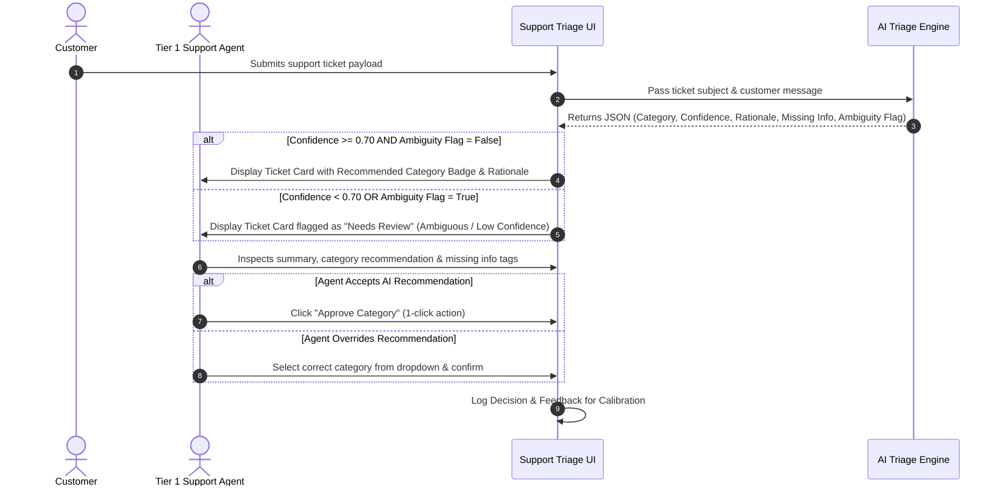

# Product Requirements Document (PRD)
## Support Triage AI — Discovery-Grounded MVP Product Definition

**Document Version:** 2.0 (MVP)  
**Author:** Product Management  
**Source of Truth:** Discovery Research Document ([`DISCOVERY.md`](file:///c:/Users/gupta/Kaam/support-ai-triage/DISCOVERY.md))  
**Target Scope:** Portfolio Case Study (AI PM + Product Design)  
**Status:** Approved for MVP Execution  

---

## 1. Problem Statement & Opportunity

### Discovery Findings Context
From frontline customer support observation and research ([`DISCOVERY.md`](file:///c:/Users/gupta/Kaam/support-ai-triage/DISCOVERY.md)), support agents perform heavy cognitive parsing on every inbound ticket: reading unstructured narratives, attempting to map fuzzy customer complaints to company routing categories, and checking whether mandatory diagnostic details are present.

### Key Pain Points
1. **High Cognitive Load:** Sifting through multi-paragraph complaints to locate core technical or billing issues requires significant mental effort, leading to fatigue.
2. **Taxonomy & Category Ambiguity:** Categories in support systems overlap (e.g., *"I can't log in because my subscription expired"* touches both Login and Billing).
3. **Information Asymmetry & Missing Context:** Customers describe symptoms without diagnostic parameters (e.g., missing account email, order ID, OS version), forcing repetitive back-and-forth detail requests.
4. **Ticket Misrouting (Ping-Pong):** Ambiguous tickets are frequently routed to the wrong specialist queue, causing internal handoffs and customer friction.

### Problem Statement
> **Problem:** Frontline support agents waste substantial time manually reading unstructured tickets, deciphering ambiguous customer intent, and identifying missing diagnostic context, leading to cognitive fatigue and ticket misrouting.  
> **Solution:** An AI-assisted triage companion that reads incoming ticket text, presents a 1–2 sentence context summary, highlights missing diagnostic parameters, recommends a category with explicit confidence, and routes ambiguous or multi-intent tickets to a human `Needs Review` workflow—keeping the agent in complete control of final routing.

---

## 2. Target User Personas

### Primary User: Tier 1 Support Agent ("Alex")
* **Role:** Frontline customer support agent handling inbound queue volume across varied topics.
* **Goals:** Grasp ticket intent quickly, send complete initial responses, minimize manual data entry, avoid misrouting.
* **Pain Points:** Context-switching fatigue, manually spotting missing troubleshooting details, anxiety over misrouting ambiguous tickets.
* **Key Need:** Instant context, transparent AI rationale, and 1-click confirmation/override.

### Secondary User / Stakeholder: Support Operations Lead ("Sarah")
* **Role:** Operations manager overseeing queue health, escalation paths, and routing quality.
* **Goals:** Maintain consistent queue throughput, minimize misrouted ticket handoffs, ensure low-confidence cases get human review.
* **Key Need:** Safety guardrails ensuring AI never takes irreversible autonomous routing actions on ambiguous tickets.

---

## 3. Product Hypothesis

> **Core Hypothesis:** If we provide Tier 1 Support Agents with an inline AI assistant that summarizes ticket intent, extracts missing parameters, recommends an initial category with transparent rationale, and flags low-confidence/multi-intent cases for human review, THEN agents will triage tickets significantly faster with fewer misroutes, WITHOUT sacrificing accuracy or agent trust.

---

## 4. Jobs-to-be-Done (JTBD)

| ID | Persona | Trigger / Situation | Job Statement (Motivation & Desired Outcome) |
|---|---|---|---|
| **JTBD-1** | Support Agent | When a new ticket enters my queue | I want to instantly view a core intent summary and category recommendation with a short explanation, so that I can validate and route the ticket in seconds without re-reading unstructured text. |
| **JTBD-2** | Support Agent | When evaluating an incomplete ticket | I want AI to automatically identify missing diagnostic information (e.g., Order ID, OS version), so that I can request the exact missing context in my initial reply. |
| **JTBD-3** | Support Ops Lead | When a ticket contains conflicting or low-confidence intents | I want the system to flag it as `Needs Review` for human review, so that ambiguous or high-risk tickets are never auto-handled incorrectly. |

---

## 5. Core User Journey Map



---

## 6. MVP Scope Definition

### What is IN Scope (MVP Prototype)
* Single-ticket processing interface demonstrating AI-assisted triage.
* **MVP Taxonomy Hypothesis Testing:** Initial category set `{Billing, Login, Refund, Technical, Needs Review}`.
* Concise rationale explanation ($\le 40$ words) referencing key phrase triggers.
* Proactive missing detail detection (e.g., Order ID, Account Email, OS Version, Screenshot, Steps to Reproduce).
* Ambiguity and low-confidence detection ($\text{Confidence} < 0.70$ or multi-intent flags $\rightarrow$ auto-assigned to `Needs Review`).
* Human-in-the-loop override interface with one-click confirmation.

### What is OUT of Scope (Explicit Non-Goals)
* ❌ **No Retrieval-Augmented Generation (RAG):** No vector search or external knowledge base ingestion.
* ❌ **No Autonomous Customer Communications:** No auto-replies sent to customers without explicit agent approval.
* ❌ **No Multi-Tenant Auth / Enterprise RBAC:** Simplified single-workspace agent view.
* ❌ **No CRM / Helpdesk Integrations:** Mock JSON ticket payloads used for prototype demonstration.
* ❌ **No Complex Analytics / BI Dashboards:** Basic local logging only.

---

## 7. Functional Requirements

### Requirement 1: Ticket Category Classification & Taxonomy Hypothesis
* **Priority:** Critical
* **User Story:** As a Tier 1 Support Agent, I want incoming tickets classified into an initial set of categories, so that tickets are organized predictably.
* **Acceptance Criteria:**
  * **Given** an unassigned ticket payload, **When** AI triage processes the text, **Then** it must output exactly one primary category tag from the MVP taxonomy set `{Billing, Login, Refund, Technical, Needs Review}`.
  * **Given** a generated category, **Then** a normalized numeric confidence score between `0.00` and `1.00` must be attached.

### Requirement 2: AI Rationale & Intent Summary
* **Priority:** Critical
* **User Story:** As a Tier 1 Support Agent, I want a 1–2 sentence explanation of why a category was chosen, so that I can quickly verify the AI's logic without re-reading the entire ticket.
* **Acceptance Criteria:**
  * **Given** an AI categorization recommendation, **When** rendered in the agent interface, **Then** the rationale explanation must be $\le 40$ words.
  * **Given** the rationale text, **Then** it must reference specific key phrases extracted from the customer message.

### Requirement 3: Missing Information Identification
* **Priority:** High
* **User Story:** As a Tier 1 Support Agent, I want the system to flag missing diagnostic parameters, so that I can request required details in my first response.
* **Acceptance Criteria:**
  * **Given** a ticket missing standard parameters (e.g., `Technical` ticket missing `App Version/OS`; `Refund` ticket missing `Transaction ID`), **When** analyzed by AI, **Then** the system returns an array of missing context tags (e.g., `["Order ID", "Date of Transaction"]`).
  * **Given** a ticket with all necessary information present, **Then** the `missing_information` array must return empty `[]`.

### Requirement 4: Ambiguity & Low-Confidence Fallback (`Needs Review`)
* **Priority:** Critical
* **User Story:** As a Support Operations Lead, I want ambiguous or low-confidence predictions flagged as `Needs Review`, so that uncertain cases are passed to human judgment.
* **Acceptance Criteria:**
  * **Given** an AI confidence score $< 0.70$, **When** processing completes, **Then** the category MUST default to `Needs Review` with tag `Reason: Low Confidence`.
  * **Given** a ticket containing $\ge 2$ strong conflicting intents, **When** processing completes, **Then** the category MUST default to `Needs Review` with tag `Reason: Multi-Intent Ambiguity`.

---

## 8. AI-Specific Requirements & Schema

### Input Payload Format
```json
{
  "ticket_id": "TCK-8921",
  "created_at": "2026-09-24T13:55:00Z",
  "subject": "Charged twice for subscription",
  "customer_message": "Hi, I checked my bank statement today and I was billed $29 twice on Sep 20th. Please help refund the duplicate payment."
}
```

### Strict Output JSON Schema
```json
{
  "category": "Refund",
  "confidence_score": 0.94,
  "explanation": "Customer identified a duplicate $29 charge on Sep 20th and requested a refund.",
  "missing_information": ["Account Email", "Invoice / Receipt Number"],
  "detected_intents": ["Refund Request", "Billing Dispute"],
  "ambiguity_flag": false,
  "requires_human_review": false
}
```

### AI Execution & Performance SLA
* **Response Latency Target:** End-to-end AI response latency must be $< 1500\text{ ms}$ for standard ticket lengths ($\le 500$ words).
* **Deterministic Output:** Low temperature setting (`0.0`) to ensure consistent classification across identical inputs.

---

## 9. Human-in-the-Loop (HITL) Requirements

1. **Human Choice Paramount:** The human agent retains 100% final responsibility for all category selections and ticket routing decisions.
2. **One-Click Approval:** Support agents can accept the recommended category with a single click or keyboard shortcut.
3. **Explicit Manual Override:** If the agent disagrees with the AI recommendation, a clear dropdown interface allows selecting a replacement category.
4. **Feedback Logging:** Overrides log both the AI prediction and the human selection for post-hoc error analysis.
5. **Zero Unattended Action:** System operates strictly as an assistive co-pilot; no ticket status changes or automated customer responses are sent without human agent trigger.

---

## 10. Structured Metrics Framework

To maintain rigor, evaluation metrics are categorized into discovery findings, product decisions, assumptions, hypotheses, and prototype evaluation targets:

```carousel
### 1. Discovery Findings (Baseline Realities)
- Agents manually parse and tag 100% of incoming tickets.
- Missing troubleshooting context forces extra back-and-forth communication turns.
- Ambiguous or emotional text leads to agent hesitation and misrouting.
<!-- slide -->
### 2. Product Decisions (Design Choices)
- Adopt an assistive human-in-the-loop co-pilot model rather than background auto-routing.
- Surface 1–2 sentence rationale explanations to build agent transparency and trust.
- Enforce strict fallback to `Needs Review` on low confidence or multi-intent inputs.
<!-- slide -->
### 3. Key Assumptions (To Be Validated)
- Support agents will trust AI recommendations if rationale is clearly explained.
- 5 categories (`Billing`, `Login`, `Refund`, `Technical`, `Needs Review`) represent a viable MVP taxonomy hypothesis.
<!-- slide -->
### 4. Product Hypotheses
- *H1:* Inline context summaries + category suggestions will reduce agent triage handling time.
- *H2:* Flagging missing details upfront will reduce customer resolution turns.
- *H3:* Routing low-confidence tickets to `Needs Review` will prevent automated misroutes.
<!-- slide -->
### 5. Measurable Prototype Evaluation Targets
- **Triage Speed Target:** $\ge 50\%$ reduction in manual triage time per ticket during prototype evaluation.
- **Top-1 Categorization Accuracy:** $\ge 85\%$ agreement rate between AI recommendation and final Human Agent selection on high-confidence predictions ($\ge 0.70$).
- **Ambiguity Safety Recall:** $100\%$ of tickets with confidence $< 0.70$ or multi-intent flags correctly routed to `Needs Review`.
- **Agent Override Rate:** $< 15\%$ manual overrides on high-confidence predictions.
```

---

## 11. Edge Cases & Handling Strategies

| Edge Case Scenario | Trigger / Condition | Expected System Behavior |
|---|---|---|
| **Empty or Junk Text** | Message contains `< 3` words, gibberish, or blank content (e.g., "help", "asdf") | Category set to `Needs Review`. Flagged missing information: `["Detailed Problem Description"]`. Confidence: `0.00`. |
| **Multi-Intent Contradiction** | Customer requests password reset AND demands a refund for a failed service. | System flags `ambiguity_flag: true`, assigns category `Needs Review`, and details both detected intents in the explanation. |
| **Missing Essential Information** | Customer reports "App crashed" without specifying OS, app version, or error text. | Category assigned as `Technical` (if confidence $\ge 0.70$), with `missing_information` array populated with `["Device OS", "App Version", "Steps to Reproduce"]`. |
| **Extremely Long Log Dump** | Customer pastes raw stack trace or log file ($> 1,000$ words). | System truncates log body for context window, extracts top error summary, assigns `Technical`, and flags missing steps to reproduce. |
| **AI Model Timeout / API Failure** | Provider API time-out or network error occurs. | System gracefully falls back to `Needs Review (System Error)` without breaking agent UI. |

---

## 12. Risks and Mitigations

| Identified Risk | Impact Level | Mitigation Strategy |
|---|---|---|
| **Automation Bias (Rubber-Stamping)** | High | Require explicit human confirmation click; highlight rationale keywords in bold text. |
| **Hallucination of Missing Information** | Medium | Implement strict extraction constraints in prompt system rules; set temperature to `0.0`. |
| **Unvalidated 5-Category Taxonomy** | Medium | Treat taxonomy as an explicit hypothesis; log all manual category overrides to inform V2 taxonomy expansion. |
| **Loss of Agent Trust on Bad Predictions** | High | Always expose confidence score and rationale; automatically route uncertain predictions ($< 0.70$) to `Needs Review`. |

---

## 13. Key Assumptions Needing Further Validation

1. **Taxonomy Hypothesis:** Whether the 5 categories (`Billing`, `Login`, `Refund`, `Technical`, `Needs Review`) sufficiently cover real-world Tier 1 ticket distribution without creating excessive "other" overflow.
2. **Rationale Length Preference:** Whether agents prefer a concise $\le 40$-word summary vs bulleted key phrases.
3. **Confidence Threshold Calibration:** Whether $0.70$ is the optimal boundary for flagging low confidence in practice.
