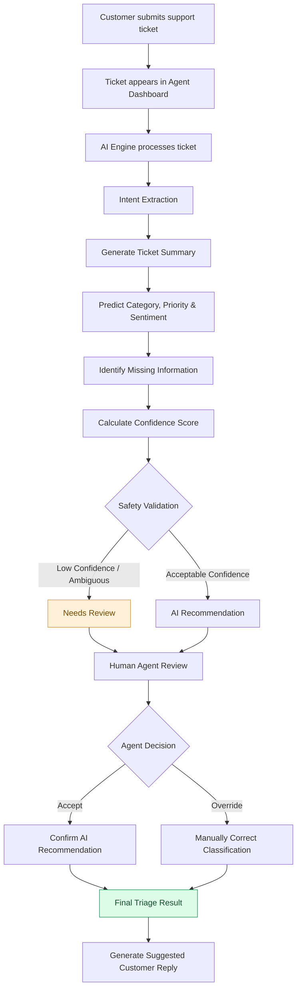
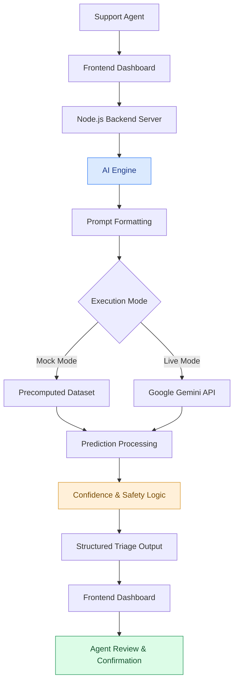
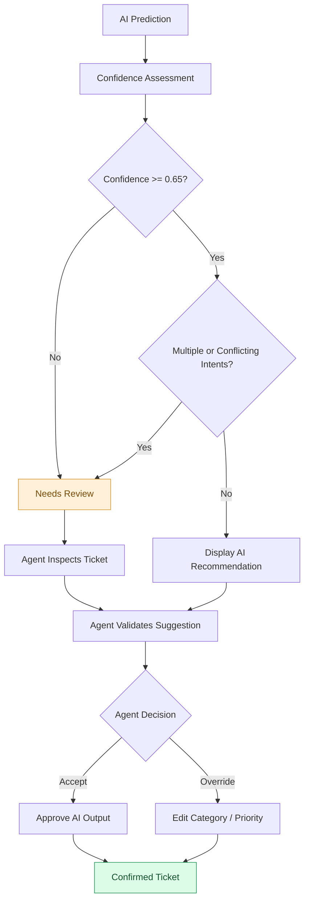
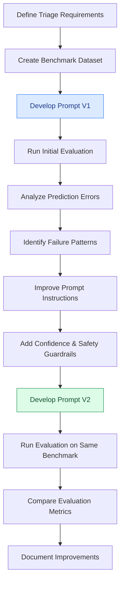

# 🎯 Support Triage AI
### An AI-Powered Support Copilot for Faster, Smarter Ticket Resolution

<p align="center">
  <strong>From unstructured customer complaints to actionable support insights.</strong>
</p>

<p align="center">
  
  
  
  
</p>

<p align="center">
  <a href="https://github.com/utkrashtsrepo/support-ai-triage">Repository</a> •
  <a href="support-triage-ai-case-study.html">Interactive Case Study</a> •
  <a href="EVALUATION.md">Evaluation Report</a>
</p>

---

## 🖥️ Product Preview

Support Triage AI is an AI-assisted triage companion designed for Tier 1 customer support teams.

It analyzes incoming customer complaints, identifies intent, predicts urgency, detects missing information, and generates suggested responses — while keeping human support agents in control.

<p align="center">
  
</p>

<p align="center">
  <i>Support Triage AI — Agent Dashboard</i>
</p>

---

## 💡 1. The Problem

Customer support agents often spend more time understanding tickets than actually resolving them.

Incoming support tickets frequently contain:

- Unstructured and ambiguous customer complaints.
- Multiple overlapping issues and categories.
- Missing diagnostic information.
- Unclear urgency and customer sentiment.
- Repetitive manual classification and response drafting.

This leads to unnecessary cognitive load, inconsistent ticket routing, and slower first-response times.

### The Solution

Build an AI copilot that assists agents with the initial ticket triage process without replacing human judgment.

| Traditional Workflow | AI-Assisted Workflow |
|---|---|
| Manually interpret complaints | AI-generated summaries |
| Guess ticket categories | Suggested classifications |
| Manually identify missing details | Automated information extraction |
| Subjective urgency assessment | AI-assisted priority prediction |
| Draft responses from scratch | Context-aware reply suggestions |
| Risk of incorrect classification | Human review and override |

**Product philosophy:** AI should reduce repetitive work, not remove human accountability.

---

## ⚡ 2. Key Features

### 🧠 Intelligent Ticket Understanding

- Converts lengthy customer complaints into concise operational summaries.
- Identifies primary intent and relevant ticket category.
- Predicts ticket priority and customer sentiment.
- Handles ambiguous and multi-intent complaints.

### 🎯 Confidence-Aware Classification

- Assigns confidence scores to AI predictions.
- Displays High, Medium, and Low confidence levels.
- Flags predictions below the configured 0.65 threshold.
- Routes uncertain cases to human review.

### 🔍 Missing Information Detection

Proactively identifies important troubleshooting details that customers haven't provided.

Examples:
- Missing Order ID.
- Missing operating system version.
- Missing screenshots or error logs.
- Incomplete account information.

### 🤝 Human-in-the-Loop (HITL)

AI recommendations are never treated as final decisions.

Agents can:

- Review AI-generated recommendations.
- Accept suggested classifications.
- Override incorrect categories.
- Send ambiguous tickets for manual review.

### ✉️ AI-Assisted Reply Generation

Generates contextual response suggestions based on the identified issue and missing information.

### 🔄 Dual Execution Modes

| Mode | Description |
|---|---|
| Mock Mode | Runs using deterministic, pre-computed ticket predictions without requiring an API key |
| Live AI Mode | Uses Google Gemini for live ticket analysis |

---

## 🔄 3. End-to-End Product Workflow

The following diagram illustrates how a customer support ticket moves through the entire system, from submission to final agent-approved triage.



### Workflow Breakdown

| Stage | What Happens |
|---|---|
| 01. Ticket Intake | Customer complaint enters the dashboard |
| 02. AI Processing | AI analyzes the ticket narrative |
| 03. Intent Detection | Identifies the issue and category |
| 04. Information Extraction | Detects missing diagnostic details |
| 05. Confidence Assessment | Evaluates prediction confidence |
| 06. Safety Validation | Determines whether human review is required |
| 07. Human Approval | Agent accepts or overrides recommendations |
| 08. Final Output | Produces confirmed triage and suggested reply |

---

## 🏗️ 4. System Architecture

The application follows a lightweight architecture consisting of a frontend dashboard, backend API proxy, AI orchestration layer, and prediction processing logic.

### High-Level Architecture



### Component Responsibilities

| Component | Responsibility |
|---|---|
| `index.html` | Main support dashboard interface |
| `server.js` | Node.js server and Gemini API proxy |
| `app.js` | Dashboard controller and application state |
| `ai-engine.js` | AI orchestration, prompt formatting and confidence logic |
| `dataset.js` | Pre-computed predictions and mock data |
| `tickets.json` | Sample customer support tickets |
| `prompts/` | Versioned AI prompts |

### AI Processing Pipeline

The AI engine handles the core intelligence of the application.

1. Receives ticket information.
2. Formats the ticket into a structured prompt.
3. Selects the configured execution mode.
4. Retrieves a prediction from the mock dataset or Gemini.
5. Processes the prediction.
6. Applies confidence and safety checks.
7. Returns structured triage recommendations to the frontend.

---

## 🛡️ 5. Human-in-the-Loop Decision System

One of the most important design decisions in this project is ensuring that AI does not make unverified decisions on behalf of support agents.

Instead of blindly trusting every prediction, the system uses confidence thresholds and ambiguity checks to determine when human intervention is necessary.

### Decision Flow



### Safety Principles

- Low-confidence predictions should not silently pass through.
- Multi-intent or conflicting tickets require additional scrutiny.
- Agents retain the ability to override AI recommendations.
- Uncertainty should be communicated rather than hidden.

**Core principle:** When the model is uncertain, the system should communicate uncertainty instead of confidently producing a potentially incorrect classification.

---

## 🧪 6. Prompt Engineering & Evaluation

The system uses an iterative prompt engineering approach to improve classification quality and safety.

Rather than optimizing only for prediction accuracy, the evaluation also considers whether the AI correctly identifies uncertainty and missing information.

### Evaluation Methodology

The system was evaluated against a benchmark dataset of 25 diverse customer support tickets covering:

- Different support categories.
- Ambiguous and multi-intent queries.
- Hostile customer complaints.
- Missing diagnostic information.
- Edge cases requiring human intervention.

### Prompt Iteration Workflow



### V1 vs V2 Results

| Evaluation Metric | Prompt V1 | Prompt V2 | Improvement |
|---|---:|---:|---:|
| Category Accuracy | 76% | **92%** | +16 percentage points |
| Average Confidence | 0.88 | **0.74** | Reduced overconfidence |
| Missing Info Detection | 48% | **88%** | +40 percentage points |
| Ambiguity Fallback | 20% | **90%** | +70 percentage points |

### Key Improvements

**1. Category Accuracy**

Improved classification through clearer category definitions and stricter prompt instructions.

**2. Confidence Handling**

Reduced overconfident predictions and encouraged more cautious outputs.

**3. Missing Information Detection**

Improved extraction of absent diagnostic parameters, helping agents identify what additional information is required.

**4. Ambiguity Handling**

Improved the system's ability to flag uncertain or conflicting tickets for human review.

> **Evaluation note:** These results come from the project's 25-ticket benchmark and should be interpreted as MVP evaluation results, not production-scale performance. Confidence and ambiguity metrics represent separate behavioral evaluation measures.

For the detailed methodology, failure analysis and prompt comparisons, see [EVALUATION.md](EVALUATION.md).

---

## 🛠️ 7. Tech Stack

| Layer | Technology |
|---|---|
| Frontend | HTML, CSS, JavaScript |
| Backend | Node.js |
| AI Model | Google Gemini 1.5 Flash |
| AI Orchestration | Custom AI Engine |
| Data Storage | JSON-based mock dataset |
| Prompt Engineering | Versioned system prompts |
| Evaluation | Benchmark-based prompt comparison |
| Visualization | Mermaid |
| Product Documentation | Markdown |

---

## 📁 8. Project Structure

```text
support-ai-triage/
│
├── index.html
├── server.js
├── tickets.json
│
├── css/
│   └── styles.css
│
├── js/
│   ├── app.js
│   ├── ai-engine.js
│   └── dataset.js
│
├── prompts/
│   ├── v1_triage_prompt.txt
│   └── v2_triage_prompt.txt
│
├── DISCOVERY.md
├── PRD.md
├── STRATEGY.md
├── EVALUATION.md
│
├── support-triage-ai-case-study.html
│
├── docs/
│   └── assets/
│       └── dashboard-preview.png
│
└── README.md
```

---

## 🚀 9. Getting Started

### Prerequisites

- Node.js 18 or higher.
- npm.
- Google Gemini API key (optional, required for live AI mode).

### Step 1: Clone the Repository

```bash
git clone https://github.com/utkrashtsrepo/support-ai-triage.git

cd support-ai-triage
```

### Step 2: Configure Environment Variables

Create a `.env` file in the project root:

```env
PORT=8080
GEMINI_API_KEY=your_gemini_api_key
GEMINI_MODEL=gemini-1.5-flash
```

**Note:** If no API key is configured, the application can run in Mock Mode using pre-computed deterministic predictions.

Keep your API key private. Never commit your `.env` file to GitHub.

### Step 3: Start the Server

```bash
node server.js
```

### Step 4: Open the Application

Navigate to:

```text
http://localhost:8080
```

---

## 📚 10. Product & Engineering Documentation

This project was developed with a product-first approach, covering the complete journey from problem discovery to implementation and evaluation.

| Document | Description |
|---|---|
| [Discovery Research](DISCOVERY.md) | User interviews, support pain points and Jobs-to-be-Done |
| [Product Requirements](PRD.md) | MVP scope, feature specifications and acceptance criteria |
| [Product Strategy](STRATEGY.md) | Product vision, roadmap and competitive positioning |
| [Evaluation Report](EVALUATION.md) | Benchmark results, prompt iterations and failure analysis |
| [Interactive Case Study](support-triage-ai-case-study.html) | Visual walkthrough of the product journey and design decisions |

---

## 🎯 11. What This Project Demonstrates

This project brings together multiple disciplines involved in building real-world AI products.

| Domain | Skills Demonstrated |
|---|---|
| AI Engineering | LLM integration, prompt engineering, AI orchestration and confidence handling |
| Product Management | Problem discovery, JTBD, PRD definition, prioritization and product strategy |
| Product Design | Agent workflows, information hierarchy and human-centered interaction design |
| Software Development | Frontend implementation, backend integration and application architecture |
| AI Evaluation | Benchmark design, comparative evaluation and error analysis |

The larger objective is to build AI products that are not just intelligent, but also reliable, explainable and useful in real-world workflows.

---

## 🔮 12. Future Scope

The current MVP establishes the foundation for a more comprehensive AI-assisted customer support system.

Potential improvements include:

- **Support Platform Integration:** Integrate with platforms such as Zendesk or Intercom.
- **Feedback-Driven Learning:** Use agent acceptance and override feedback to identify recurring model errors.
- **Expanded Evaluation:** Increase benchmark size and introduce more complex edge cases.
- **Agent Analytics:** Track acceptance rates, override rates and review frequency.
- **Context-Aware Triage:** Retrieve historical tickets to provide additional context.
- **Performance Measurement:** Measure actual improvements in first-response time and ticket resolution efficiency.

---

## 📄 13. License

Released under the MIT License for demonstration and portfolio purposes.

---

<p align="center">
  <strong>Built with curiosity, product thinking, and a human-first approach to AI.</strong>
</p>

<p align="center">
  <a href="https://github.com/utkrashtsrepo">GitHub</a> •
  <a href="https://github.com/utkrashtsrepo/support-ai-triage">Repository</a>
</p>
