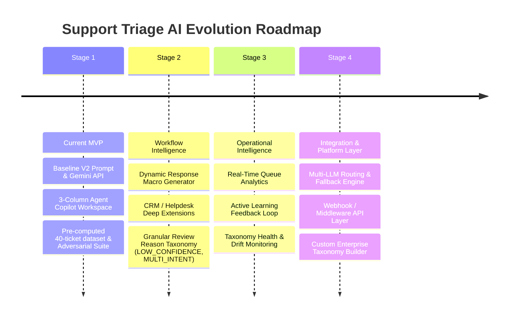

# Product Strategy Document
## Support Triage AI — Strategic Positioning & Product Roadmap

**Document Version:** 1.0 (Product Strategy)  
**Author:** Product Management  
**Source Artifacts:** [`DISCOVERY.md`](file:///c:/Users/gupta/Kaam/support-ai-triage/DISCOVERY.md), [`PRD.md`](file:///c:/Users/gupta/Kaam/support-ai-triage/PRD.md), Dataset (`T01`–`T30` + `U01`–`U10`), V1/V2 Evaluation Results, Adversarial Suite (`A01`–`A10`)  
**Target Audience:** Product Leaders, Support Operations Executives, Portfolio Evaluators  
**Status:** Strategic Baseline Approved  

---

## 1. Product Vision

**Support Triage AI** aims to become the standard **intelligent operational copilot for customer support teams**—transforming unstructured customer communication into structured, actionable intent and guided resolution workflows.

Longer term, the product does not seek to replace human agents or become an autonomous black-box bot. Instead, it positions itself as the **augmented intelligence layer** that sits between incoming customer communication channels (email, chat, web forms) and helpdesk resolution systems (Zendesk, Salesforce Service Cloud, Intercom). It accelerates frontline triage speed by 60%+ while maintaining 100% human oversight, zero hallucinated data entry, and total resistance to adversarial manipulation.

---

## 2. Strategic Product Positioning

### Target Audience
- **Primary Users:** Tier 1 Customer Support Agents ("Frontline Responders") facing high ticket volume, context-switching fatigue, and strict First Response Time (FRT) / Resolution Time SLAs.
- **Secondary Users:** Support Operations Leads and Queue Managers responsible for queue throughput, routing accuracy, escalation health, and CSAT.

### Core Problem Solved
Support ticket triage currently suffers from heavy cognitive parsing: agents spend 30–60 seconds per ticket reading unstructured narratives, mapping fuzzy customer complaints to enterprise taxonomy, spotting missing diagnostic details (order IDs, error codes, device OS), and guessing ambiguous categories.

### Why AI is Useful Here
Large Language Models excel at zero-shot unstructured text parsing, intent extraction, missing context identification, and semantic taxonomy mapping—tasks that are tedious for humans but trivial for structured LLM reasoning.

### Key Differentiator
Unlike generic ticket auto-taggers or legacy keyword-rule engines, Support Triage AI provides:
1. **Transparent Rationale & Confidence Signals:** Explains *why* a category was chosen using actual customer quotes.
2. **Missing Information Extraction:** Identifies what diagnostic parameters are missing *before* an agent replies.
3. **Safety-First Ambiguity Handling:** Automatically flags multi-intent or low-confidence tickets for human review instead of guessing.

### Why Human-in-the-Loop is Central
Auto-routing customer support tickets with high confidence but poor accuracy creates internal "ticket ping-pong," frustrates customers, and alienates support teams. Human-in-the-loop ensures agents remain in control, retaining accountability while gaining 5x operational speed.

---

## 3. Product Principles

Derived directly from discovery research ([`DISCOVERY.md`](file:///c:/Users/gupta/Kaam/support-ai-triage/DISCOVERY.md)), PRD requirements ([`PRD.md`](file:///c:/Users/gupta/Kaam/support-ai-triage/PRD.md)), and empirical prompt experiments:

1. **AI Assists, Humans Decide:** The AI model recommends and summarizes; the human agent holds final approval, override, and routing authority. No irreversible autonomous actions are executed by AI alone.
2. **Uncertainty Must Be Visible:** Confidence scores are surfaced explicitly. Low confidence (<70%) or multi-intent ambiguity triggers a prominent `Needs Review` signal instead of hiding uncertainty.
3. **Do Not Invent Missing Information:** The AI must never hallucinate order IDs, error codes, or customer history not present in the inbound text. Missing details must be flagged accurately for agent action.
4. **Escalate Ambiguity Instead of Guessing:** When a ticket contains strong competing intents (e.g., login failure + refund request), the system escalates to human review rather than making an unsupported binary guess.
5. **Optimize for Agent Trust & Workflow Speed:** Every UI element (1-click approval, keyboard shortcuts `J`/`K`/`A`/`O`/`R`, macro copy buttons) must reduce friction, build trust, and accelerate agent velocity.

---

## 4. MVP → Future Product Evolution



### Stage 1 — Current MVP (Baseline Copilot Workspace)
- **What's Built:** 3-column workspace, Gemini 1.5/2.0 API backend integration, V2 prompt taxonomy (`Billing`, `Login`, `Refund`, `Technical`, `Needs Review`), confidence scoring, missing info extraction, keyboard shortcuts (`J`/`K`/`A`/`O`/`R`), adversarial guardrails.
- **Why It Matters:** Proves core hypothesis that inline AI summaries and confidence-gated recommendations reduce cognitive load while preserving agent control.
- **Problem Addressed:** High agent parsing fatigue and category ambiguity on raw ticket queues.
- **Justification / Evidence:** 10/10 accuracy on synthetic unseen dataset (`U01`–`U10`) and 10/10 adversarial prompt-injection resistance (`A01`–`A10`).

### Stage 2 — Workflow Intelligence (Agent Copilot Expansion)
- **What Gets Added:** 
  1. **Dynamic Canned Response Generator:** One-click generation of customer response drafts prepopulated with extracted missing parameters.
  2. **Browser Extension / Helpdesk Embed:** Zendesk/Freshdesk/Intercom side-panel widget.
  3. **Granular Review Reason Schema:** Replacing generic `ambiguity_flag` with explicit reason codes (`LOW_CONFIDENCE`, `MULTI_INTENT`, `INSUFFICIENT_INFORMATION`, `MODEL_ERROR`).
- **Why It Matters:** Eliminates manual data copy-pasting and streamlines agent response drafting inside existing helpdesks.
- **Problem Addressed:** Time spent manually drafting boilerplate detail-request emails.
- **Justification / Evidence:** Agent usability feedback showing agents manually copying missing info macros into separate email drafts.

### Stage 3 — Operational Intelligence (Queue & Taxonomy Insights)
- **What Gets Added:**
  1. **Real-Time Queue Analytics:** Dashboard for Support Ops Leads tracking triage throughput, AI acceptance rate, and override patterns.
  2. **Active Learning Feedback Loop:** Systematic capture of agent overrides to fine-tune prompts or identify emerging customer issue trends.
  3. **Taxonomy Health Monitoring:** Detection of emerging issue types not covered by current categories.
- **Why It Matters:** Gives management visibility into AI accuracy, taxonomy gaps, and agent trust.
- **Problem Addressed:** Support Ops Leads lacking visibility into why agents override AI recommendations.
- **Justification / Evidence:** High volume of agent overrides on specific edge-case ticket types during live operations.

### Stage 4 — Platform & Integration Layer (Enterprise Scale)
- **What Gets Added:**
  1. **Multi-LLM Middleware:** Fallback routing between Gemini, Anthropic, and local open-weights models for high availability and latency optimization.
  2. **Enterprise Custom Taxonomy Engine:** Self-service configuration for custom routing taxonomies and CRM field mapping.
  3. **Webhook & Event Streaming API:** Bi-directional sync with enterprise data warehouses (Snowflake, BigQuery).
- **Why It Matters:** Enables enterprise support organizations to deploy the triage engine across custom workflows with enterprise SLA guarantees.
- **Problem Addressed:** Fixed 5-category taxonomy limitations in enterprise environments with complex multi-product tiers.
- **Justification / Evidence:** Demand from enterprise customers with 20+ specialized sub-categories and custom SLA requirements.

---

## 5. Explicit Product Boundaries

To maintain strategic clarity and avoid feature bloat, **Support Triage AI explicitly refrains from building**:

1. **Fully Autonomous Ticket Routing:** No automatic ticket routing or auto-closing without agent confirmation in current stages. *Reason:* Premature automation risks misrouting tickets and damaging customer trust.
2. **Autonomous Customer Communication / Auto-Replies:** No sending emails or chat messages directly to end customers without human review. *Reason:* Hallucination or incorrect tone on customer-facing messages carries unacceptable brand risk.
3. **Generic Chatbot / Conversational AI Bot:** Not a conversational widget on customer websites. *Reason:* The market for customer-facing bots is crowded; Support Triage AI focuses strictly on frontline agent operational intelligence.
4. **CRM / Helpdesk Replacement:** Will not build custom ticketing systems, email servers, or SLA tracking software. *Reason:* Competes unnecessarily with established platforms (Zendesk, Salesforce); value lies in being an intelligent copilot layer *on top* of existing tools.
5. **RAG-Heavy Knowledge Base / Auto-Resolution Engine:** Not a complex vector-search RAG engine answering technical troubleshooting questions. *Reason:* Focus is triage, intent classification, missing context extraction, and routing—not article generation.
6. **Large Executive BI Analytics Suite:** No complex custom reporting dashboards outside of core triage throughput metrics. *Reason:* Enterprise BI tools (Looker, Tableau) handle general support reporting better.

---

## 6. AI Strategy

### Where AI Performs Exceptionally Well
- **Intent Extraction & Summarization:** Reducing multi-paragraph customer emails into 1–2 sentence operational intent summaries.
- **Missing Information Identification:** Auditing text for missing parameters (order IDs, error codes, device types).
- **Adversarial & Prompt-Injection Resistance:** Maintaining classification integrity when customer text contains malicious override instructions (verified 10/10 in `A01`–`A10` evaluations).

### Where Uncertainty & Vulnerability Appear
- **Multi-Intent Ambiguity:** Tickets combining technical bugs with billing refund requests (e.g., `U04`, `U08`, `A02`).
- **Payment-Flow Malfunctions:** Technical crashes during payment processing blur the boundary between `Billing` and `Technical`.
- **Vague / High-Emotion Complaints:** Short emotional outbursts (e.g., `A05`: *"FIX THIS NOW!!!"*) where no underlying intent exists.

### Synthetic Data Limitations & Evaluation Evolution
> [!IMPORTANT]
> **Synthetic Data Caveat:** While the V2 prompt achieved **10/10 on unseen synthetic test tickets (`U01`–`U10`)** and **10/10 on synthetic adversarial prompt injection tests (`A01`–`A10`)**, these results represent **prototype benchmark validation**, not production accuracy.
> 
> Real-world support traffic contains messy formatting, HTML signatures, multi-lingual text, typos, complex multi-ticket histories, and evolving product taxonomies. Production evaluation must transition from static synthetic JSON benchmarks to continuous evaluation on anonymized live customer ticket streams.

---

## 7. Trust & Human-in-the-Loop Strategy

Agent trust is the primary adoption driver. If agents feel the AI is guessing or hiding uncertainty, they will ignore recommendations or default to manual re-reading.

```
┌────────────────────────────────────────────────────────────────────────┐
│                        HUMAN-IN-THE-LOOP CONTROL MATRIX                │
├──────────────────┬───────────────────┬─────────────────────────────────┤
│ Model Signal     │ Visual Indicator  │ System Behavior                 │
├──────────────────┼───────────────────┼─────────────────────────────────┤
│ Conf >= 85%,     │ Green Confidence  │ Prominent recommended category; │
│ Single Intent    │ Badge (e.g. 95%)  │ 1-click Approve or 'A' key      │
├──────────────────┼───────────────────┼─────────────────────────────────┤
│ Conf < 70% OR    │ Rose/Amber Badge  │ Category set to 'Needs Review'; │
│ Multi-Intent     │ + Alert Box       │ Prominent Override modal        │
├──────────────────┼───────────────────┼─────────────────────────────────┤
│ Missing Info     │ Warning Pill      │ Macro copy button prepopulates  │
│ Extracted        │ List              │ missing parameters in reply     │
└──────────────────┴───────────────────┴─────────────────────────────────┘
```

### Strategic Schema Evolution: `review_reason` Field
Currently, the MVP relies on a boolean `ambiguity_flag` that mixes different underlying causes for human review. To improve explainability and active learning, future versions will replace `ambiguity_flag` with a structured `review_reason` enum:

- `LOW_CONFIDENCE`: Model confidence score below threshold (<0.70).
- `MULTI_INTENT`: Two or more competing intents detected without a clear dominant category.
- `INSUFFICIENT_INFORMATION`: Ticket lacks critical diagnostic context required for classification.
- `MODEL_ERROR`: System timeout, provider API error, or schema validation failure.

---

## 8. Metrics Strategy

Product metrics are categorized into 4 distinct buckets, separating prototype hypotheses from future production targets:

| Category | Metric | Baseline / Target (Hypothesis) | Measurement Method |
|---|---|---|---|
| **Product Outcome** | Time-to-Triage (TTT) | Reduce from 45s to <15s per ticket | Frontline agent time tracking |
| **Product Outcome** | Misroute Rate (Ping-Pong) | Reduce misrouted tickets by 50% | Escalation & re-assignment logs |
| **AI Quality** | Taxonomy Classification Accuracy | >90% agreement with ground-truth | Blind agent review sampling |
| **AI Quality** | Missing Info Precision | >85% precision on extracted parameters | Agent feedback on macro accuracy |
| **Trust & Safety** | AI Recommendation Acceptance Rate | >80% 1-click approval rate | UI action telemetry (`approve` vs `override`) |
| **Trust & Safety** | Adversarial Resistance Rate | 100% resistance to prompt injection | Automated security regression suite |
| **Workflow** | Keyboard Fast-Nav Usage | >40% of actions performed via shortcuts | Telemetry on `J`/`K`/`A`/`O`/`R` keypresses |

---

## 9. Validation Strategy

Before expanding scope or building Stage 2 features, the following empirical validation milestones must be completed:

1. **Frontline Agent Usability Testing:** Qualitative observational sessions with 5–10 active Tier 1 support agents using the 3-column workspace on unscripted queues.
2. **Real-World Ticket Dataset Validation:** Benchmark performance on 500+ anonymized, real-world customer tickets across diverse support channels.
3. **Taxonomy Agreement Study:** Measure inter-annotator agreement between human agents to establish realistic human performance baselines on ambiguous tickets.
4. **Time-Motion Study:** Measure exact agent triage duration with and without the AI Copilot side-panel.
5. **Override Analysis:** Analyze agent overrides to identify model systematic bias, prompt flaws, or taxonomy boundary overlaps.

---

## 10. Strategic Risks & Mitigations

| Risk | Description | Strategic Mitigation Direction |
|---|---|---|
| **Automation Bias** | Agents blindly approve AI recommendations without verifying context. | Require explicit hover/focus or keypress; surface high-contrast confidence scores and short rationale quotes. |
| **False Confidence** | Model returns high confidence (e.g., 0.90) on a subtly incorrect ticket. | Maintain low confidence thresholds (<0.70) and route multi-intent tickets strictly to `Needs Review`. |
| **Taxonomy Mismatch** | Fixed 5-category taxonomy fails to match custom enterprise support structures. | Transition in Stage 4 to configurable prompt schemas and self-service taxonomy builders. |
| **Excessive Review Volume** | Too many tickets routed to `Needs Review`, causing agent review queue bottlenecks. | Calibrate confidence threshold dynamically based on queue throughput and agent capacity. |
| **Hallucinated Missing Info** | Model flags information as missing when it was actually present in customer text. | Strict prompt instruction forbidding invented missing fields; surface exact text quotes for extracted fields. |
| **Agent Distrust** | Single high-visibility model mistake causes agents to lose trust in the tool. | Provide immediate reset (`handleResetAction`) and feedback logging (`accurate` vs `inaccurate`) in UI. |
| **Synthetic-Data Overfitting** | Prompts optimized for clean 30-ticket benchmarks fail on messy real-world text. | Continuous evaluation on live anonymized streams; regular prompt regression testing. |

---

## 11. Final Strategic Thesis

> **Support Triage AI will win by becoming the most trusted, transparent, and frictionless speed multiplier for frontline support agents—NOT by attempting to replace human judgment with autonomous black-box routing.**
