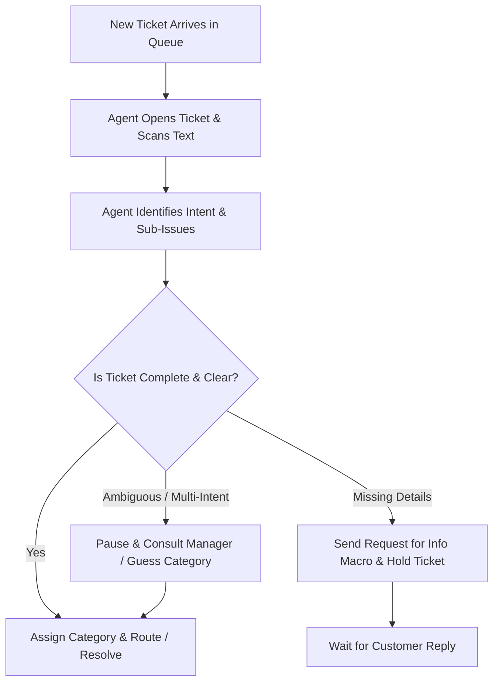

# Product Discovery: Support Ticket Triage

> **Project Name:** Support Triage AI  
> **Role:** AI Product Manager & Product Designer  
> **Document Type:** Product Discovery & Problem Space Exploration  
> **Workspace File:** [DISCOVERY.md](file:///c:/Users/gupta/Kaam/support-ai-triage/DISCOVERY.md)  
> **PRD Reference:** [PRD.md](file:///c:/Users/gupta/Kaam/support-ai-triage/PRD.md)

---

## 1. Problem Space & Context

Support ticket triage is the frontline operational process of receiving, parsing, categorizing, and routing inbound customer support inquiries to the appropriate resolution path.

Before jumping into AI classification architectures or automated routing models, this discovery document explores the human, operational, and informational dynamics of ticket triage to ensure we build for genuine user needs.

---

## 2. User Segmentation & Stakeholders

| Segment | Role | Key Motivations | Main Pain Points |
|---|---|---|---|
| **Primary** | *Tier 1 Support Agent* | Resolve tickets quickly, hit FRT/MTTR SLAs, avoid misrouting. | Cognitive fatigue from reading unstructured text, missing details, context switching. |
| **Secondary** | *Support Ops Lead* | Queue throughput, balanced workloads, high triage accuracy. | Inconsistent routing SLAs, high handoff costs, ping-pong tickets. |
| **Indirect** | *Tier 2/3 Specialized Teams* | Receive fully contextualized, relevant tickets. | Receiving misrouted or incomplete tickets from Tier 1. |

---

## 3. Current Triage Workflow & Micro-Tasks



### Micro-Tasks Performed
1. **Unstructured Parsing:** Sifting through multi-paragraph complaints to locate core technical/billing issues.
2. **Detail Audit:** Verifying whether account IDs, transaction dates, OS versions, or screenshots are included.
3. **Intent Categorization:** Mapping stated problems to company taxonomy (`Billing`, `Login`, `Refund`, `Technical`).
4. **Routing Execution:** Applying tags, setting priority flags, or assigning to specialist queues.

---

## 4. Key Discovery Findings: Pain Points & Edge Cases

> [!WARNING]
> **Major Operational Friction Points:**
> 1. **Cognitive Fatigue:** Reading 50+ unstructured emails daily causes mental exhaustion and late-shift routing errors.
> 2. **Taxonomy Blur:** Overlapping boundaries (e.g., "Can't log in because subscription expired" $\rightarrow$ `Login` vs `Billing`).
> 3. **Incomplete Tickets:** Customers report "App crashes" without OS or version details $\rightarrow$ causes 1+ extra back-and-forth turns.
> 4. **Multi-Intent Conflicts:** Single-tag systems fail when customer requests a password reset AND a refund in one ticket.
> 5. **Ambiguous / Emotional Text:** High-emotion text ("Fix this now!") lacks facts, leading to guessing.

---

## 5. Jobs-to-be-Done (JTBD)

* **JTBD-1 (Rapid Intent Parsing):**  
  *When* a new ticket enters my queue, *I want to* instantly grasp the core issue and rationale, *so that* I can categorize and assign it in seconds without reading dense text.
* **JTBD-2 (Proactive Detail Auditing):**  
  *When* reviewing an inbound request, *I want to* immediately spot missing diagnostic information, *so that* I can request exact missing details in my initial reply.
* **JTBD-3 (Safe Ambiguity Management):**  
  *When* encountering a multi-intent or poorly defined ticket, *I want* clear signals highlighting the ambiguity, *so that* high-risk cases receive human review rather than bad auto-routing.

---

## 6. Separation of Known Facts, Assumptions & Hypotheses

```carousel
### Known Facts (Observed / Validated)
- Support agents perform manual reading and tagging on every inbound ticket.
- Incomplete tickets cause resolution delays due to extra back-and-forth communication turns.
- Customer support messages frequently mix emotional narrative with technical details.
<!-- slide -->
### Assumptions (To Be Tested)
- Support agents will trust AI recommendations if accompanied by a 1–2 sentence explanation.
- 5 core categories (`Billing`, `Login`, `Refund`, `Technical`, `Needs Review`) cover the vast majority of Tier 1 tickets.
- Agents prefer an assistive recommendation UI over 100% fully automated background routing.
<!-- slide -->
### Hypotheses (For MVP Validation)
- *H1:* Showing AI-suggested categories + rationale reduces ticket triage time by $> 50\%$.
- *H2:* Routing low-confidence ($< 0.70$) tickets to `Needs Review` maintains high overall routing accuracy ($\ge 85\%$).
- *H3:* Proactively flagging missing parameters reduces resolution back-and-forth turns.
```

---

## 7. Non-Leading User Research Validation Script

To validate discovery findings with real support agents using *The Mom Test* framework:

1. *"Walk me through the last ticket you triaged today. How did you decide where it belonged?"*
2. *"Tell me about a recent ticket that took you a long time to categorize. What made it difficult?"*
3. *"How do you handle tickets where a customer asks for two completely different things in one email?"*
4. *"When you realize a ticket is missing information, what exact steps do you take next?"*
5. *"Tell me about a time a ticket was routed to the wrong team. How was that error discovered, and what was the impact?"*
