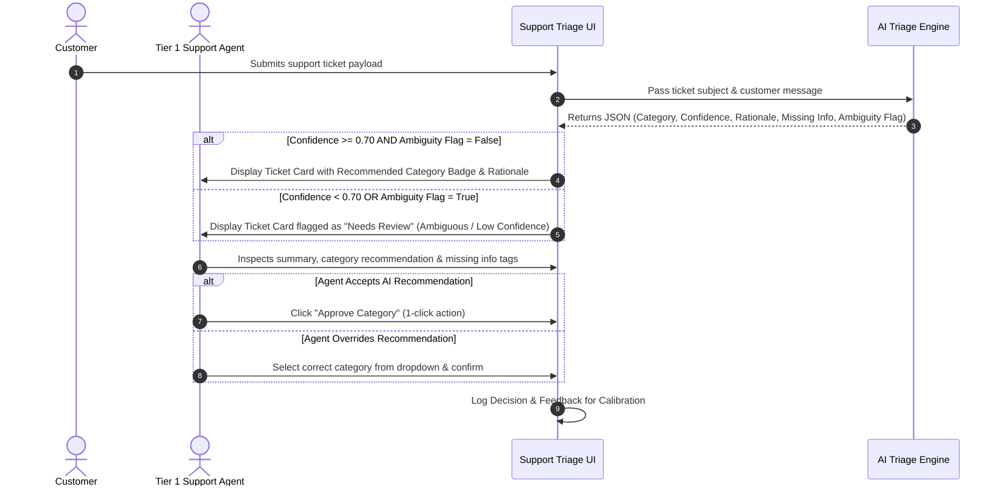

# Portfolio Case Study: Support Triage AI — Discovery-Grounded MVP PRD

> **Project Name:** Support Triage AI  
> **Role:** Lead AI Product Manager & Product Designer  
> **Source of Truth:** Discovery Research Document ([`DISCOVERY.md`](file:///c:/Users/gupta/Kaam/support-ai-triage/DISCOVERY.md))  
> **Document Type:** Product Requirements Document (PRD) v2.0  
> **Artifact File:** [PRD.md](file:///c:/Users/gupta/Kaam/support-ai-triage/PRD.md)

---

## 1. Problem Statement & Opportunity

### Grounded Discovery Context
From user observation and discovery research ([`DISCOVERY.md`](file:///c:/Users/gupta/Kaam/support-ai-triage/DISCOVERY.md)), Tier 1 Support Agents perform heavy cognitive parsing on every incoming ticket: reading unstructured narratives, attempting to map fuzzy complaints to company routing categories, and checking whether mandatory diagnostic details are present.

### Quantified Problem Statement
> **Problem:** Support agents waste substantial time manually reading unstructured tickets, deciphering ambiguous customer intent, and identifying missing diagnostic context, leading to cognitive fatigue and ticket misrouting.  
> **Solution:** An AI-assisted triage companion that reads incoming ticket text, presents a 1–2 sentence context summary, highlights missing diagnostic parameters, recommends a category with explicit confidence, and routes ambiguous or multi-intent tickets to a human `Needs Review` workflow—keeping the agent in complete control of final routing.

---

## 2. Product Hypothesis & JTBD

> **Product Hypothesis:** If we provide Tier 1 Support Agents with an inline AI assistant that summarizes ticket intent, extracts missing parameters, recommends an initial category with transparent rationale, and flags low-confidence/multi-intent cases for human review, THEN agents will triage tickets significantly faster with fewer misroutes, WITHOUT sacrificing accuracy or agent trust.

### Jobs-to-be-Done (JTBD)
* **JTBD-1 (Rapid Intent Parsing):** *When* a new ticket enters my queue, *I want to* instantly view a core intent summary and category recommendation with a short explanation, *so that* I can validate and route the ticket in seconds without re-reading unstructured text.
* **JTBD-2 (Proactive Detail Auditing):** *When* evaluating an incomplete ticket, *I want* AI to automatically identify missing diagnostic information (e.g., Order ID, OS version), *so that* I can request the exact missing context in my initial reply.
* **JTBD-3 (Safe Ambiguity Management):** *When* a ticket contains conflicting or low-confidence intents, *I want* the system to flag it as `Needs Review` for human review, *so that* ambiguous or high-risk tickets are never auto-handled incorrectly.

---

## 3. User Journey Map



---

## 4. Scope & Non-Goals

```carousel
### In-Scope for MVP Prototype
- **MVP Taxonomy Hypothesis Testing:** Initial category set `{Billing, Login, Refund, Technical, Needs Review}`.
- **Short Rationale Explanation:** 1–2 sentence rationale ($\le 40$ words) referencing key phrase triggers.
- **Missing Information Extraction:** Proactive detection of missing logs, order numbers, or OS details.
- **Low-Confidence / Ambiguity Fallback:** Automatic routing to `Needs Review` if confidence $< 0.70$ or multi-intent flags present.
- **Human-in-the-Loop Override:** 1-click confirmation or category override dropdown.
<!-- slide -->
### Out-of-Scope (Explicit Non-Goals)
- ❌ **No RAG (Retrieval-Augmented Generation):** No vector search or external knowledge base indexing.
- ❌ **No Autonomous Customer Communications:** Zero customer-facing messages sent without agent review.
- ❌ **No Complex Analytics:** Lightweight local log tracking instead of heavy BI pipelines.
- ❌ **No CRM Integration:** Mock JSON data structures used for portfolio demonstration.
- ❌ **No Multi-Tenant Auth:** Single workspace agent workflow.
```

---

## 5. Structured Metrics Framework

```carousel
### 1. Discovery Findings (Baseline Realities)
- Agents manually parse and tag 100% of incoming tickets.
- Missing troubleshooting context forces extra back-and-forth communication turns.
- Ambiguous or emotional text leads to agent hesitation and misrouting.
<!-- slide -->
### 2. Product Decisions (Design Choices)
- Adopt an assistive human-in-the-loop co-pilot model rather than background auto-routing.
- Surface 1–2 sentence rationale explanations to build agent transparency and trust.
- Enforce strict fallback to `Needs Review` on low confidence or multi-intent inputs.
<!-- slide -->
### 3. Key Assumptions (To Be Validated)
- Support agents will trust AI recommendations if rationale is clearly explained.
- 5 categories (`Billing`, `Login`, `Refund`, `Technical`, `Needs Review`) represent a viable MVP taxonomy hypothesis.
<!-- slide -->
### 4. Product Hypotheses
- *H1:* Inline context summaries + category suggestions will reduce agent triage handling time.
- *H2:* Flagging missing details upfront will reduce customer resolution turns.
- *H3:* Routing low-confidence tickets to `Needs Review` will prevent automated misroutes.
<!-- slide -->
### 5. Measurable Prototype Evaluation Targets
- **Triage Speed Target:** $\ge 50\%$ reduction in manual triage time per ticket during prototype evaluation.
- **Top-1 Categorization Accuracy:** $\ge 85\%$ agreement rate between AI recommendation and final Human Agent selection on high-confidence predictions ($\ge 0.70$).
- **Ambiguity Safety Recall:** $100\%$ of tickets with confidence $< 0.70$ or multi-intent flags correctly routed to `Needs Review`.
- **Agent Override Rate:** $< 15\%$ manual overrides on high-confidence predictions.
```

---

## 6. Edge Cases & Risks

> [!IMPORTANT]
> **Key Edge Cases & System Behaviors:**
> 1. **Empty / Junk Message:** Default to `Needs Review`, flag `missing_information: ["Problem Description"]`, confidence `0.00`.
> 2. **Multi-Intent Contradiction:** E.g., password reset request + refund request $\rightarrow$ Set `ambiguity_flag: true`, category `Needs Review`.
> 3. **Extremely Long Stack Trace:** Truncate input payload safely, parse primary exception, assign `Technical`, flag missing reproduction steps.
> 4. **API Failure / Timeout:** Fall back gracefully to `Needs Review (System Error)` without crashing agent UI.
